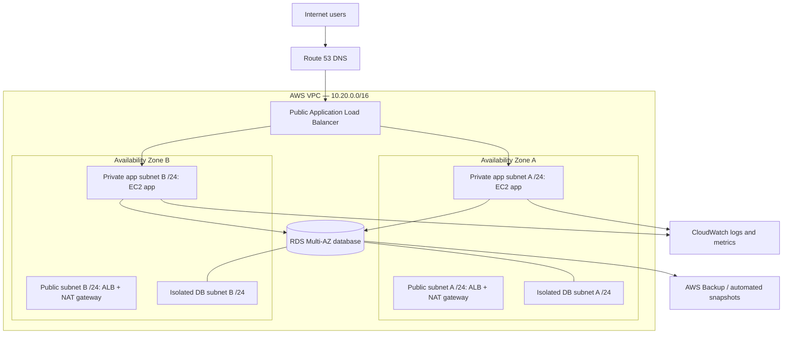

# AWS Cloud Infrastructure Design

**Portfolio project | Cloud infrastructure • Networking • Security • Business continuity**

## Project overview
This project designs a secure, highly available AWS environment for a fictional small business hosting a customer-facing web application. It is a **design and documentation exercise**, not a deployed AWS environment. All IP ranges and workloads are illustrative; no production resources or AWS charges are required.

## Architecture at a glance

*Conceptual diagram; subnet placement and arrows are simplified. The load balancer has interfaces in both public subnets. The database uses a DB subnet group spanning both isolated subnets.*

## Design goals
- Support application availability across two Availability Zones.
- Keep application instances and the database off the public internet.
- Permit HTTPS to the public application load balancer only.
- Monitor infrastructure health and define recovery procedures.
- Explain networking, access controls, cost considerations, and tradeoffs.

## Proposed AWS services
| Service | Purpose |
|---|---|
| Amazon VPC | Isolated virtual network and routing |
| Public/private/isolated subnets | Separate ingress, application, and database tiers |
| Internet Gateway | Public ingress and egress for public subnets |
| NAT Gateway (one per AZ) | Outbound connectivity for private app subnets |
| Application Load Balancer | HTTPS termination and distribution to app instances |
| EC2 Auto Scaling | App capacity and replacement across two AZs |
| Amazon RDS Multi-AZ | Managed database with standby and automatic failover |
| Route 53 | DNS alias to the load balancer |
| AWS Certificate Manager | TLS certificate for HTTPS |
| CloudWatch / CloudTrail | Monitoring, alerts, and audit logs |
| AWS Backup | Centralized backup policy and recovery planning |
| IAM / Systems Manager | Least-privilege access and remote management without SSH ingress |

## Repository contents
- [Network and subnet plan](docs/network-plan.md)
- [Security architecture](docs/security-design.md)
- [Availability, backup and recovery](docs/operations-and-recovery.md)
- [Cost and implementation tradeoffs](docs/cost-and-tradeoffs.md)
- [Deployment validation checklist](docs/validation-checklist.md)
- [Standalone Mermaid diagram](diagrams/architecture.mmd)

## How to review
1. Read the architecture diagram above (GitHub renders Mermaid in Markdown).
2. Review the subnet, routing, and security-group design.
3. Follow the deployment validation checklist to understand how this architecture would be tested if implemented.

## Scope and honesty note
No live AWS account, resources, screenshots, performance tests, or cost measurements were used. The repository demonstrates architectural reasoning and technical documentation; deployment and validation remain future work.

## Future enhancements
- Implement the architecture with Terraform in a sandbox AWS account.
- Add CI checks for infrastructure-as-code security and formatting.
- Test ALB health checks, instance replacement, and RDS failover.
- Replace NAT-based egress where practical with VPC endpoints.

## References
- [AWS VPC documentation](https://docs.aws.amazon.com/vpc/latest/userguide/what-is-amazon-vpc.html)
- [Application Load Balancer documentation](https://docs.aws.amazon.com/elasticloadbalancing/latest/application/introduction.html)
- [RDS Multi-AZ deployments](https://docs.aws.amazon.com/AmazonRDS/latest/UserGuide/Concepts.MultiAZ.html)
- [AWS Well-Architected Framework](https://docs.aws.amazon.com/wellarchitected/latest/framework/welcome.html)
